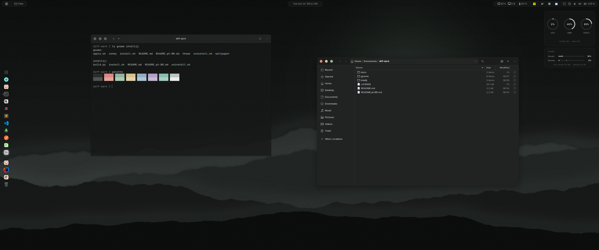
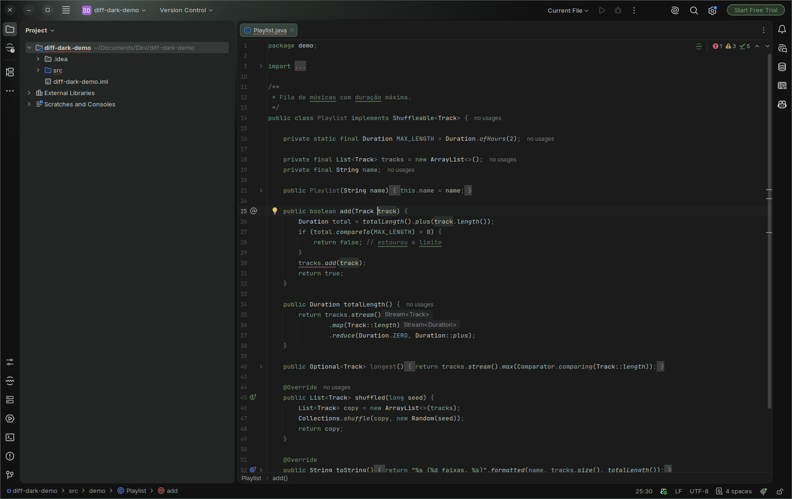

# Diff Dark

**English** · [Português](README.pt-BR.md)

A minimal dark theme in neutral greys with a thread of green. Sage `#8fb39d` is the only
accent and shows up sparingly: selection, cursor, focus, method calls.





Two **independent** parts. Install one, the other, or both:

| Part | What it themes | Install | Uninstall |
|---|---|---|---|
| [`gnome/`](gnome/) | GTK 3/4, GNOME Shell, icons, fonts, dock, menu, terminal, system widget, wallpaper | `gnome/install.sh` | `gnome/uninstall.sh` |
| [`intellij/`](intellij/) | IntelliJ IDEA UI and editor (and other JetBrains IDEs 2025.3+) | `intellij/install.sh` | `intellij/uninstall.sh` |

```bash
git clone https://github.com/ferreiravpl/diff-dark.git ~/diff-dark
~/diff-dark/gnome/install.sh      # desktop
~/diff-dark/intellij/install.sh   # IDE (with IntelliJ open, or pass its install path)
```

Uninstalling puts every setting back the way it was before the install and removes
everything the installer downloaded.

## Palette

| Role | Color |
|---|---|
| Background (windows / editor) | `#202322` / `#1a1b1a` |
| Surfaces | `#161817` · `#1b1d1c` · `#2a2d2c` |
| Borders | `#3a3e3c` |
| Text | `#eceeed` · secondary `#9aa09d` |
| Accent | `#8fb39d` (sage) · dark `#4f7d63` |
| Error / warning | `#d98880` / `#d6c08e` |

The greys sit at hue ~150° with under 5% saturation: they read as neutral, but they
match the green.

## What stays out of this repository

No third-party files are redistributed. Everything is downloaded or generated at install time:

- **GTK/Shell theme:** built from [Colloid](https://github.com/vinceliuice/Colloid-gtk-theme)
  at a pinned commit, with the palette in `gnome/theme/palette.scss`.
- **IntelliJ theme:** generated from the Islands Dark theme bundled with the installer's own IDE.
- **Icons, fonts, extensions and Conky:** downloaded from their official sources, at pinned versions.

## License

[GPL-3.0](LICENSE). `gnome/theme/palette.scss` is a modified version of a Colloid file,
which is also GPL-3.0.
